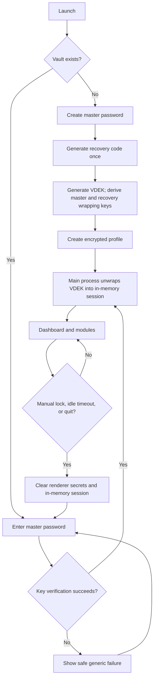
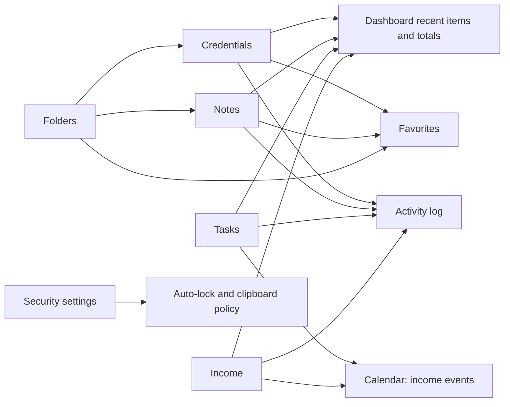

# System Flow — Deskkeep

## 1. Vault lifecycle



## 2. Credential creation and use

```mermaid
sequenceDiagram
  participant U as User
  participant R as Renderer
  participant M as Main/Vault service
  participant D as SQLite
  U->>R: Add credential or generate password
  R->>R: Validate fields and show preview
  R->>M: credentials.create(validated input)
  M->>M: Confirm unlocked session and validate sender
  M->>M: Encrypt payload with vault key
  M->>D: Transaction: persist envelope + activity event
  D-->>M: Commit
  M-->>R: Safe credential summary
  U->>R: Reveal/copy password
  R->>M: credentials.reveal(id, user-requested)
  M-->>R: Secret only for deliberate action
  R->>R: Visible feedback; clear clipboard after timeout
```

## 3. Cross-module projections



## 4. Backup, import, and reset

| Flow | Preconditions | Safe path | Failure behavior |
|---|---|---|---|
| Encrypted backup | Vault unlocked; destination chosen | Build versioned encrypted archive, write atomically, then log outcome | Do not leave a partial final file; report destination error without secrets |
| Encrypted restore | Source selected; password supplied | Validate manifest → decrypt to staging → migrate → validate → explicit merge/replace → commit | Active vault remains unchanged until staging succeeds |
| CSV import | Source selected; mapping validated | Preview counts/errors → explicit warning → staged transaction → commit → report | Invalid rows are reported; no partial silent import |
| CSV export | Scope selected | Warn plaintext → create file → log export | No automatic cloud upload or share |
| Reset vault | User types confirmation phrase | Confirm profile only → remove current local vault → reopen first-run setup | User exports are never targeted; cancellation leaves data untouched |

## 5. App navigation

```text
Locked → Unlock
Unlocked → Dashboard
Dashboard → Vault | Notes | Tasks | Calendar | Income | Folders | Favorites
Tools → Password generator | Activity log | Settings
Any unlocked screen → Lock
```

The sidebar is a stable primary navigation surface. Module actions use clear add/search/filter controls; high-risk security/data controls live only in Settings.
