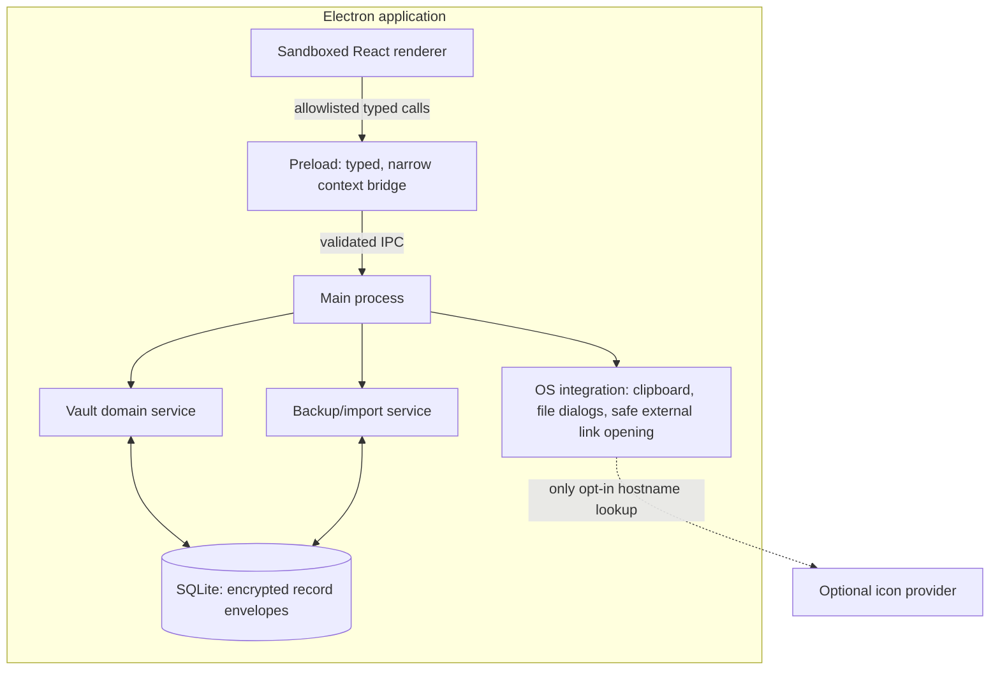
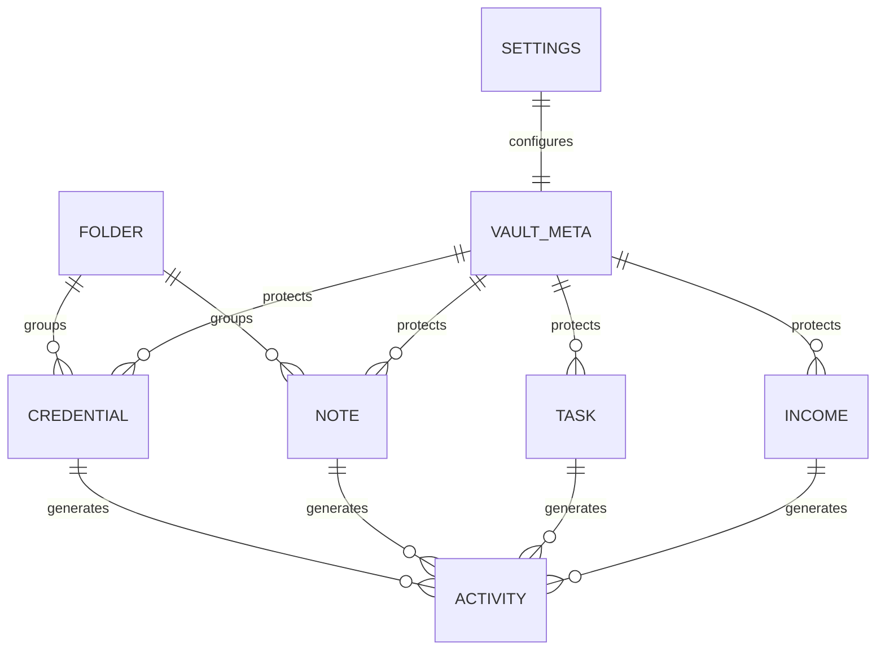

# System Design — Deskkeep

## 1. Design score

**Current design score: 9/10 for the approved v1 scope.** It has explicit requirements, local capacity assumptions, trust boundaries, recovery path, quality gates, and deferred scaling. It reaches 10/10 once the user approves the product name/platform/sync boundary and the implementation team validates the crypto parameters, packaging toolchain, and recovery UX on target Windows hardware.

## 2. Scope and scale

Deskkeep is intentionally not a distributed system in v1. One person uses one local vault, normally with fewer than 10,000 records and a few hundred MB of encrypted database/attachments (attachments are excluded from v1). This means zero network QPS, zero server cost, no cache, no queue, and no replication. SQLite plus an in-memory unlocked-session index is the simplest correct design.

The product's resilience objectives are local:

- **RPO:** Since last encrypted backup; the app cannot recover a lost local drive without a user-created backup.
- **RTO:** Under five minutes to install, select a backup, and restore a healthy vault on a replacement machine.
- **Availability:** Works offline; OS/device availability is the limiting factor.

## 3. High-level design

## 4. Trust boundaries

| Boundary | Trust level | Rule |
|---|---|---|
| Renderer | Lower trust | May be compromised by UI/XSS bugs; cannot access Node, disk, secrets, or generic IPC. |
| Preload | Privileged bridge | Exposes only minimal, argument-filtered APIs through `contextBridge`. |
| Main/vault domain | High trust | Validates sender/session/input; owns crypto keys and persistence. |
| Local SQLite and backup files | Untrusted at rest | Contents may be copied; sensitive values must remain encrypted and integrity-checked. |
| Clipboard | Semi-trusted OS surface | Secret copy requires intent and timed clearing; user is warned about OS history. |
| Network | Out of scope by default | No server calls. Optional icons are a separately visible preference. |

## 5. Data design

The vault uses a normalized structural schema for IDs/relationships plus encrypted payload envelopes. That gives us transactions and migrations without sacrificing the privacy of titles, note bodies, passwords, income, or activity details.

All dashboard and calendar values are derived locally from the unlocked session. There are no denormalized cloud projections that could become inconsistent. Dates are stored as ISO local-date values for due dates/income dates; timestamps are UTC. Currency amounts are integer minor units plus ISO currency code.

## 6. Critical design details

### Locking and memory

The main process owns an explicit session state machine: `first_run → locked → unlocking → unlocked → locking`. IPC methods declare their allowed state. Locking clears secret-bearing renderer stores, discards the in-memory search index, closes detail/reveal screens, and releases key references. JavaScript cannot promise physical memory zeroization, so the product must honestly promise best-effort session clearing—not impossible guarantees.

### Search

For v1 scale, decrypt records into an unlocked memory index and search there. Persisting plaintext full-text search indexes would undermine the vault. Search results sent to the renderer contain only the minimal summaries needed to render the screen.

### Recovery

The recovery code derives a separate key that unwraps the same random VDEK protected by the master password. It is displayed once at vault creation and regenerated only through an authenticated, unlocked flow; successful recovery immediately requires a new master password. The PRD must state plainly that loss of both master password and recovery code makes the vault unrecoverable by design.

### Backups

Backups are user-operated encrypted archives, not background cloud replication. Restore performs staging and integrity checks before it touches the active profile. This choice prevents a broken/corrupt import from destroying the only copy.

## 7. Tradeoffs

| Decision | Benefit | Cost/mitigation |
|---|---|---|
| Offline local-only v1 | Strong privacy, simple operation, no hosting cost | No multi-device access; future sync is a separate E2EE project |
| Per-record encrypted payloads | Useful SQLite transactions and private fields | Search happens only in unlocked memory |
| Electron | Fast React/TypeScript delivery and cross-platform option | Larger binary/attack surface; harden renderer and pin dependencies |
| No browser extension/autofill | Smaller attack surface and scope | Manual copy/paste remains the v1 experience |
| User-created backups | User controls data location | Must teach recovery and test restore aggressively |

## 8. Operational plan

- Use a clean, per-test data directory for all automated and packaged acceptance runs.
- Maintain a migration ledger and test upgrade from every released schema version.
- Sign production Windows installers before public distribution; publish checksums and a release note with upgrade/back-up guidance.
- Run dependency/security review before each release and keep Electron current on its supported line.
- Never add telemetry or network services by default; require a product decision and privacy update first.

## 9. Future scale path—not part of v1

Optional multi-device sync needs a new design with encrypted client-side blobs, per-device keys, conflict handling, remote deletion semantics, recovery changes, server metadata minimization, and independent security review. It must not be added as an ordinary API/database extension to this local vault.
